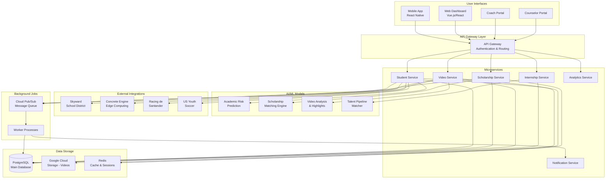
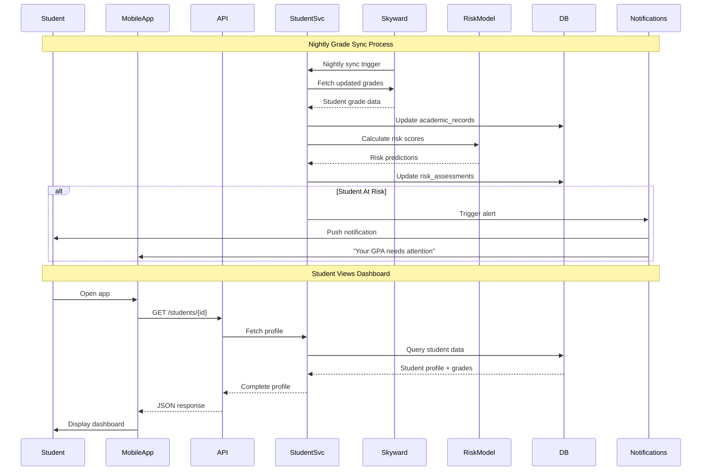
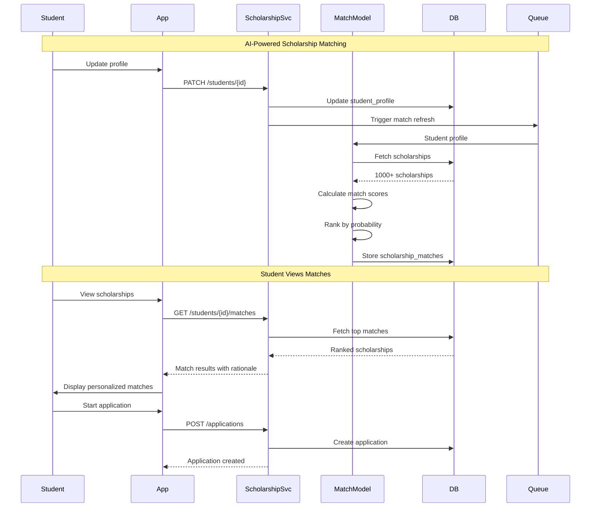
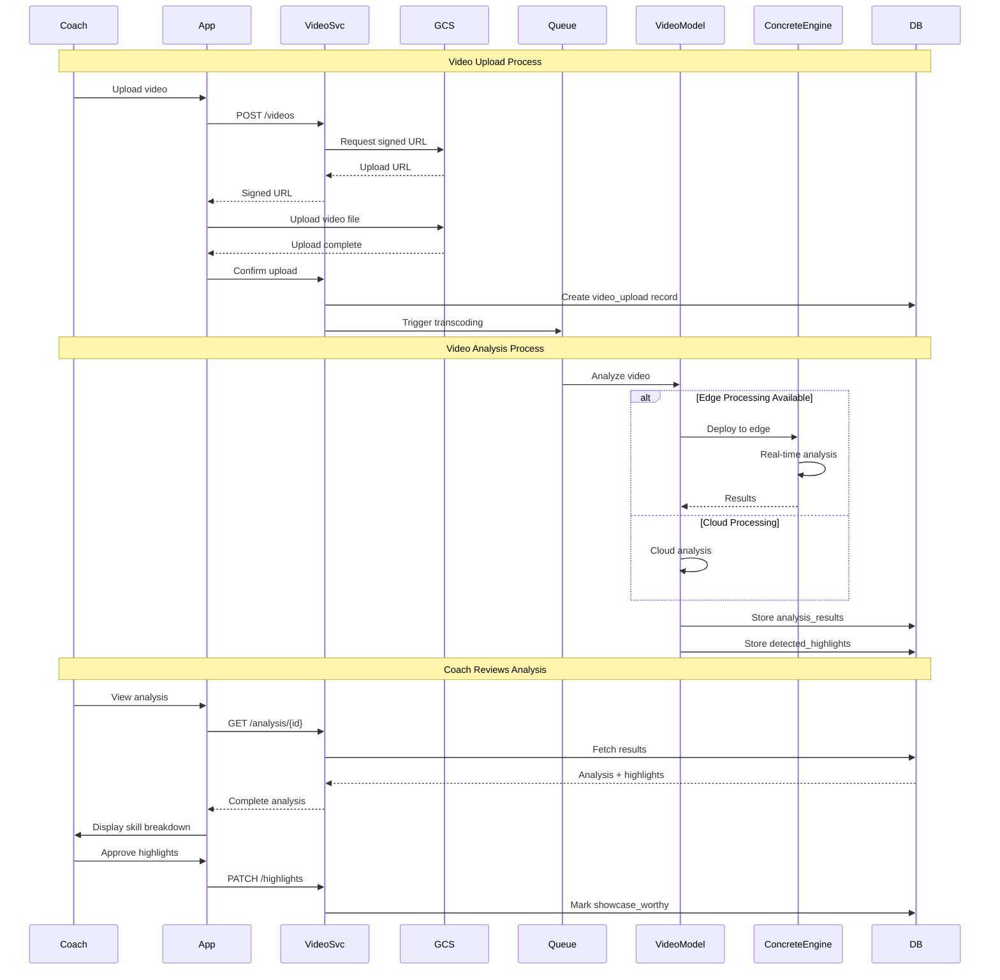
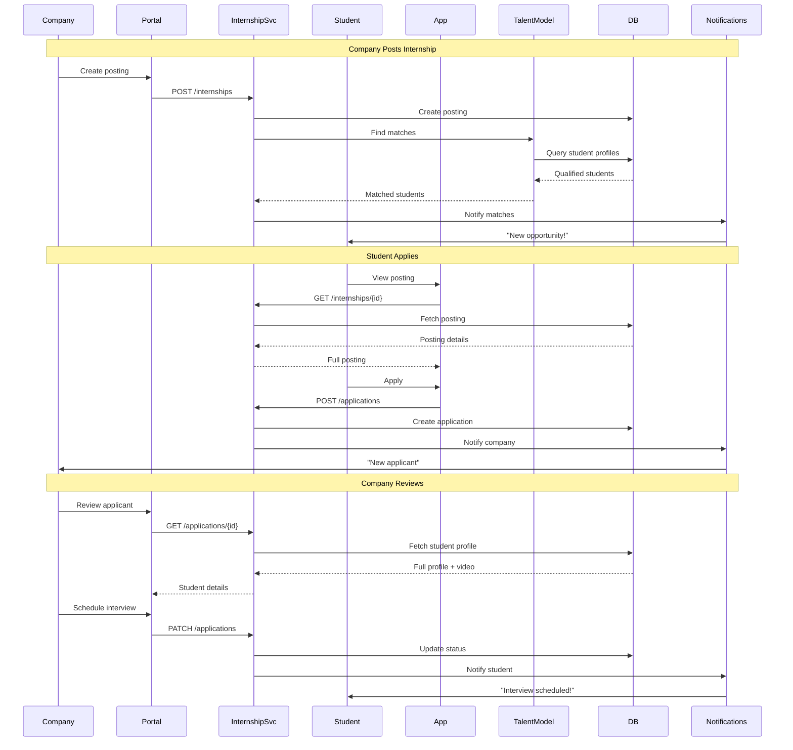
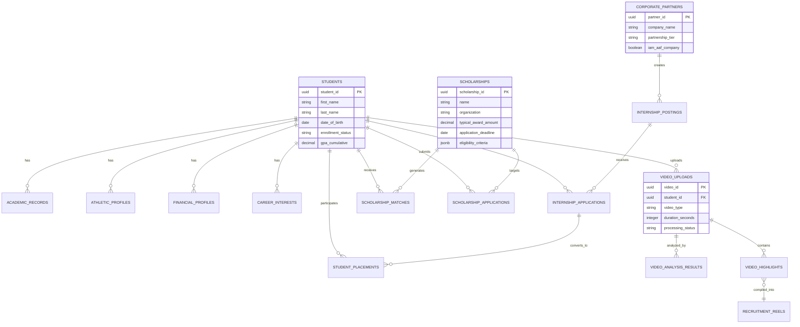
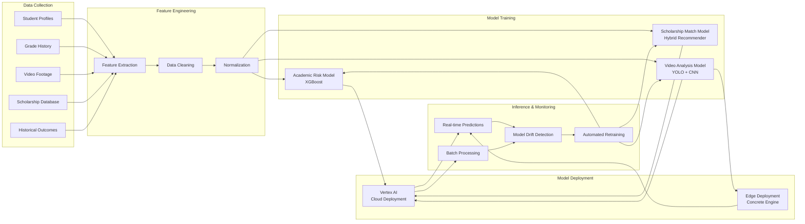
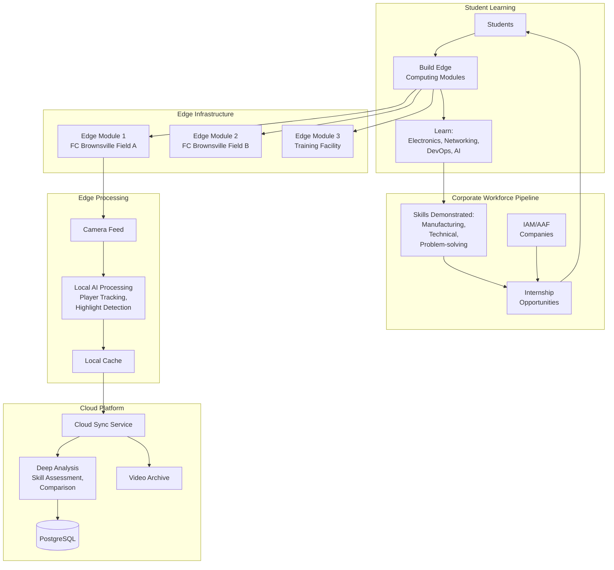
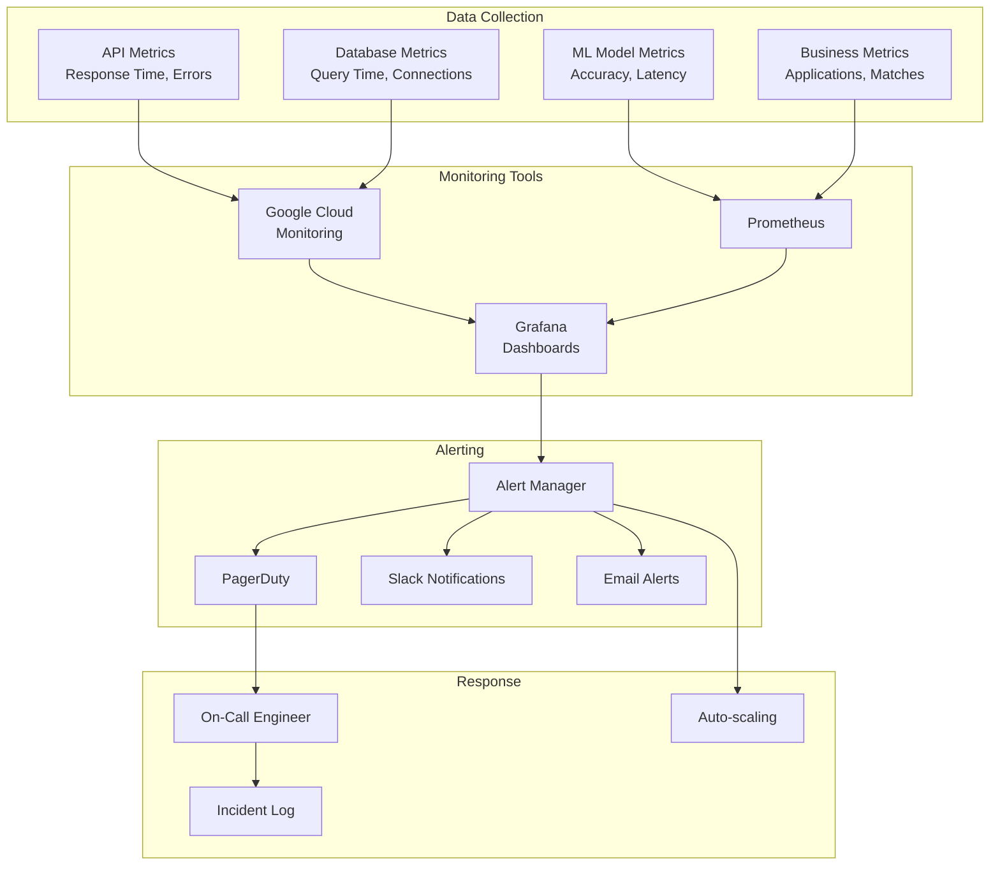

# TX Futures Alliance - System Architecture Diagrams

## High-Level System Overview

## Student Data Flow

## Scholarship Matching Flow

## Video Upload & Analysis Flow

## Internship Application Flow

## Data Relationships Diagram

## ML Model Pipeline

## Concrete Engine Integration

## System Monitoring & Alerting

---

## How to Use These Diagrams

### Viewing Mermaid Diagrams
1. **GitHub/GitLab:** Renders automatically in markdown
2. **VS Code:** Install "Mermaid Preview" extension
3. **Online:** Paste into https://mermaid.live/
4. **Export:** Use mermaid-cli to generate PNG/SVG

### When to Reference
- **System Overview:** Understanding how everything connects
- **Data Flow:** Debugging issues or planning features
- **Entity Relationships:** Database design and queries
- **ML Pipeline:** Model training and deployment
- **Monitoring:** Setting up observability

### Updating Diagrams
As you build and architecture evolves, update these diagrams:
1. Add new services/integrations
2. Document new data flows
3. Update entity relationships
4. Track ML model versions

---

## Architecture Decision Records (ADRs)

### Why PostgreSQL?
- FERPA compliance requires ACID transactions
- Complex queries (joins across students, scholarships, videos)
- Strong ecosystem for Python/Node.js
- Managed service available (Cloud SQL)
- Alternative considered: MongoDB (rejected - lacks relational integrity)

### Why Microservices?
- Independent scaling (video processing ≠ scholarship matching)
- Team autonomy (different developers, different services)
- Tech flexibility (Python for ML, Node for real-time)
- Deployment independence (update one service without affecting others)

### Why React Native?
- Cross-platform (iOS + Android from one codebase)
- Large community and mature ecosystem
- Students/parents need mobile-first experience
- Alternative considered: Flutter (rejected - smaller talent pool)

### Why Google Cloud?
- Existing familiarity
- Strong ML/AI services (Vertex AI)
- Good nonprofit pricing
- Excellent Kubernetes support
- Alternative considered: AWS (similar, went with familiarity)

---

These diagrams represent the complete system architecture. Reference them as you build to ensure all pieces connect properly.
